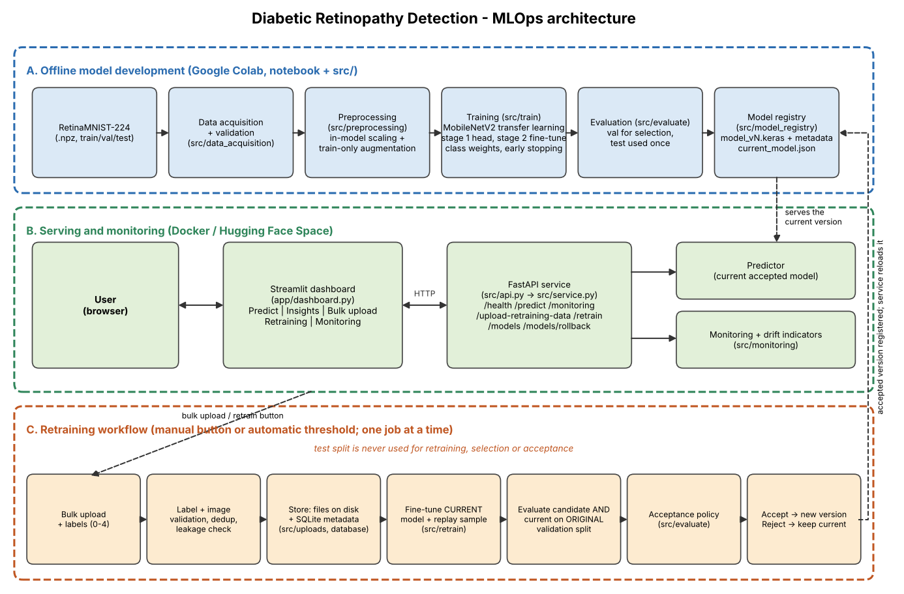

# Architecture and design decisions



## 1. Components
| Layer | Module(s) | Responsibility |
|---|---|---|
| Data | `src/data_acquisition.py`, `src/reference.py` | load/validate RetinaMNIST (shape, dtype, labels, blank images, duplicates, **cross-split leakage**); provide original train/val data for replay and hashes of train/val/test for leakage checks (test images are only hashed, never kept) |
| Preprocessing | `src/preprocessing.py`, `src/image_analysis.py` | strict image validation (JPEG/PNG by content, size limits, truncation), RGB + square + 224×224, label validation, `tf.data` pipeline, augmentation block; brightness/contrast/sharpness for insights and drift |
| Model | `src/model.py`, `src/train.py`, `src/gradcam.py` | MobileNetV2 + GAP + Dropout + Dense(5); two-stage training; macro-F1 early stopping; search; Grad-CAM |
| Evaluation | `src/evaluate.py` | metrics (accuracy, loss, macro/weighted P/R/F1, per-class, confusion matrix, OvR ROC-AUC, QWK, within-one), integrity check, **acceptance policy** |
| Registry | `src/model_registry.py` | versioned `.keras` + JSON metadata, current pointer, history, rollback, atomic writes |
| Persistence | `src/database.py`, `src/uploads.py` | SQLite (uploads, predictions, retraining events, model versions); images stay on disk under content-hash names |
| Retraining | `src/retrain.py` | `RetrainingManager` (eligibility, single-flight lock, background job, auto-trigger) + `KerasTrainer` |
| Service | `src/service.py`, `src/monitoring.py` | all application behaviour (no HTTP) – predictor hot-swap, logging, uploads, retraining, rollback, monitoring snapshot, shift indicators |
| API | `src/api.py` | thin FastAPI layer: validation → service call → status codes |
| UI | `app/dashboard.py`, `app/api_client.py`, `app/ui_helpers.py` | Streamlit pages; talks to the API only |
| Ops | `Dockerfile`, `docker-compose.yml`, `scripts/` | container, bootstrap/seeding, health check, e2e + flood tools, Space bundle, submission ZIP |

## 2. Workflows
**Training (Colab):** dataset → validate → EDA → stage 1 (head) → stage 2 (fine-tune) → search → final model → evaluate (validation; test once) → save → reload round-trip check → register as an accepted version.

**Serving:** dashboard → `POST /predict` → validate and preprocess (same function as training) → current accepted model → probabilities + version → logged (success/failure, latency, class, image statistics – never the image or file name).

**Retraining:**
```
bulk upload → label validation → image validation → duplicate / leakage rejection → files on disk + SQLite row
   → [button or automatic threshold] → eligibility check → lock (one job at a time) → event row 'running'
   → reload uploads through the shared preprocessing (unreadable/leaked files excluded) → stratified replay sample
   → load CURRENT model, score it on the original validation split → fine-tune top layers (small lr, early stopping)
   → integrity check → save candidate → re-load it and re-check → score candidate on validation
   → acceptance policy → register version (accepted | rejected) → accepted: switch pointer, service reloads
   → event row updated with metrics + decision (or 'failed'/'skipped' with a message; the current model is never touched on failure)
```

## 3. Key design decisions and why
| Decision | Rationale |
|---|---|
| **MobileNetV2 transfer learning** | small, fast on CPU for serving, pretrained features suit a 1k-image dataset; matches the assignment brief |
| **Scaling + augmentation inside the model** | one definition of preprocessing for training, API and retraining → no double normalisation, no train/serve skew; augmentation is inactive at inference by Keras semantics |
| **Macro-F1 for selection/early stopping** | classes are imbalanced (45 % vs 6 %); accuracy rewards predicting "No DR" |
| **Class weights, not oversampling** | no duplicated images are created, so nothing pretends to be new data |
| **Extra metrics: quadratic weighted kappa, within-one accuracy** | DR grades are ordered; confusing 2 with 3 is less severe than 0 with 4 |
| **Test set used once; never in retraining/acceptance** | avoids optimistic reporting and leakage; uploads identical to val/test/train images are rejected |
| **Image-statistics baseline** | the EDA showed brightness/framing correlate with the label; the baseline quantifies how much a "photographer's shortcut" can explain |
| **Replay sample + small lr + top layers only** | with tens of new images, unrestricted fine-tuning would overfit or forget |
| **Acceptance policy (4 rules)** | training finishing is not evidence of improvement; the per-class recall guard stops a model trading away a rare severe class for a small macro-F1 gain |
| **File-based registry + SQLite mirror** | simple, inspectable, atomic; the registry (not the database) is the source of truth for what is served |
| **Single-flight lock + "attempted" marking** | prevents concurrent/expensive duplicate jobs and automatic retry loops after failure |
| **Service layer separate from FastAPI** | behaviour is unit-testable without the web framework |
| **API on localhost inside the Space; dashboard password for admin pages** | only one port is public; protects data-changing pages on a public demo |
| **Hugging Face Docker Space** | free CPU tier, Docker support, a shareable URL; limits are documented in `deployment.md` |

## 4. Failure handling
Invalid file → 422 and a failed-prediction record. No model → 503 and `degraded` health. Model reload failure → previous predictor keeps serving. Training crash → event `failed`, nothing changed.
Corrupt candidate file → rejected at the re-load check. Restart during training → stale `running` event is marked `failed` on start-up. Missing dataset → predictions work; retraining/drift disabled with an explanation.

## 5. Testing strategy
Unit tests for every pure component; integration tests run dashboard → client → service → database → registry through an in-process transport; controllable fake trainer for retraining logic; mutation checks on the safeguards.
Not covered by automated tests in the build environment: real TensorFlow code paths, real FastAPI request parsing and real Streamlit rendering (see `test_status.md`; `colab_run_app_and_tests.ipynb` exercises them).
